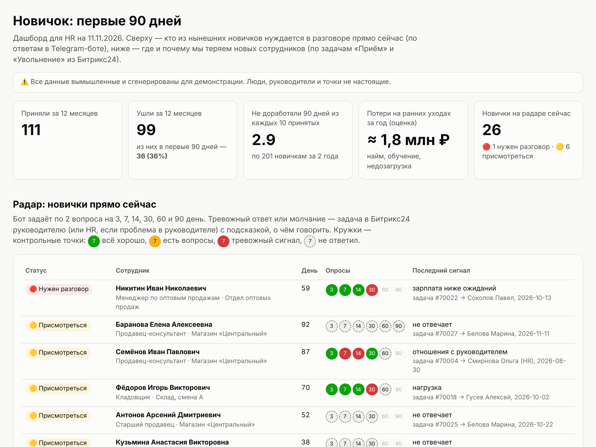

# «Новичок»: удержание сотрудников в первые 90 дней

Тестовое задание, слово «НОВИЧОК». Отчёт с объяснениями для HR лежит в [REPORT.md](REPORT.md).

Три части, которые работают вместе:

1. **Telegram-бот для новичка.** Он:
   - задаёт по 2 вопроса «как дела» на 3, 7, 14, 30, 60 и 90 день работы;
   - отвечает на вопросы по базе знаний (ИИ-помощник);
   - даёт кнопку «🆘 Нужна помощь».
2. **Сигналы в Битрикс24.** На тревожный ответ, молчание или просьбу о помощи бот ставит задачу руководителю или HR и подсказывает, о чём говорить.
3. **Дашборд для HR** ([reports/dashboard.html](reports/dashboard.html)). На нём видно, где, когда и почему уходят новички, и кто из нынешних новичков нуждается в разговоре прямо сейчас.

Все данные вымышленные. Генератор строит правдоподобную выгрузку задач «Приём» и «Увольнение» из Битрикс24 за 2 года, примерно для 400 сотрудников.



## Быстрый старт

Нужен Python 3.11 или новее.

```bash
pip install -r requirements.txt
```

Сгенерировать данные, прогнать симуляцию и собрать дашборд:

```bash
python -m novichok setup
```

Открыть `reports/dashboard.html` в браузере. Интернет не нужен.

### Попробовать бота без Telegram (в терминале)

```bash
python -m novichok chat
```

Дальше введите `/demo`, выберите подразделение и «перематывайте» время командами `/day 3`, `/day 7`, `/day 14`, `/day 30`. Кнопки нажимаются вводом номера. Любой другой текст — вопрос помощнику, например «когда зарплата?».

### Запустить Telegram-бота

1. Создайте бота у [@BotFather](https://t.me/BotFather) и получите токен.
2. Скопируйте `.env.example` в `.env` и впишите токен:

   ```bash
   cp .env.example .env
   ```

3. Запустите бота:

   ```bash
   python -m novichok bot
   ```

4. Напишите боту `/demo`.

В демо-режиме копия каждой «задачи в Битрикс24» приходит в тот же чат. Так один человек видит обе стороны: новичка и HR.

Можно также войти под «настоящим» новичком из сгенерированных данных: `/start NV-xxxx`. Коды печатает команда `setup`. Если HR отправит новичку ссылку `https://t.me/<бот>?start=NV-xxxx`, код подставится сам.

Чтобы обновить дашборд после тестов в боте:

```bash
python -m novichok dashboard
```

## Настройки (`.env`)

| Переменная | Что делает |
|---|---|
| `TELEGRAM_BOT_TOKEN` | Токен бота. |
| `ANTHROPIC_API_KEY` | Если задан, ответы формулирует Claude, строго по статьям базы знаний. Без ключа бот отдаёт подходящую статью целиком. |
| `ANTHROPIC_MODEL` | Модель Claude, по умолчанию `claude-opus-5-5`. |
| `BITRIX_WEBHOOK_URL` | Входящий вебхук Битрикс24 (право «Задачи»). Если задан, задачи создаются по-настоящему через `tasks.task.add`. Без него — имитация в таблице `bitrix_outbox`, она видна в дашборде. |
| `HR_CHAT_IDS` | Telegram chat_id сотрудников HR, через запятую. Им дублируются сигналы. Свой id покажет команда `/myid`. |
| `TICK_SECONDS` | Как часто бот проверяет, кому отправить опрос. По умолчанию раз в час, опросы уходят только с 10:00 до 20:00. |

## Устройство

```
novichok/
  generate_data.py  генератор выгрузки Битрикс24 (data/bitrix_export.json)
  importer.py       разбор задач «Приём»/«Увольнение» → сотрудники (SQLite)
  pulse.py          вопросы, расписание, правила риска, подсказки для разговора
  engine.py         вся логика бота, не зависит от Telegram
  bot.py            Telegram-адаптер (python-telegram-bot)
  cli_chat.py       тот же бот в терминале
  assistant.py      ИИ-помощник: поиск BM25 по kb/ + Claude (опционально)
  bitrix.py         создание задач: вебхук или имитация
  simulate.py       прогон текущих новичков через настоящий движок
  analytics.py      показатели
  dashboard.py      HTML-дашборд без внешних библиотек
kb/                 база знаний для новичков (вымышленные регламенты)
tests/              тесты (pytest)
```

Логика бота отделена от Telegram. Поэтому один и тот же движок работает в Telegram, в терминале, в симуляции и в тестах.

Запуск тестов:

```bash
python -m pytest -q
```
