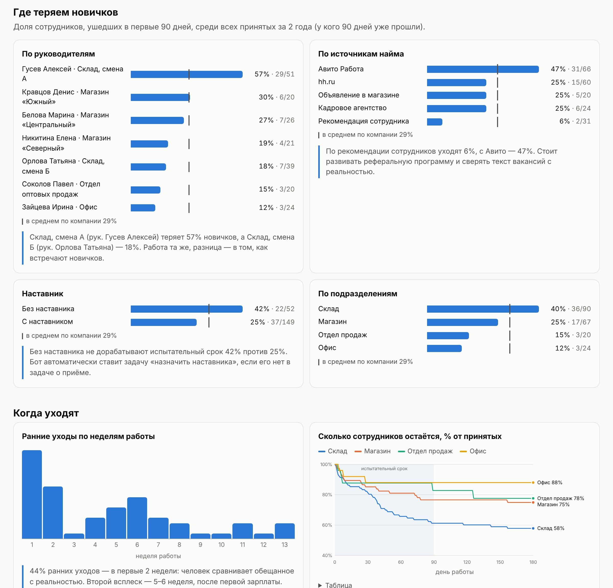

# Отчёт по тестовому заданию «НОВИЧОК»

## 1. Какую задачу я решал

Из условия: за год приходит больше 100 новых людей, и **каждый третий из ушедших не доработал до трёх месяцев**. Значит, слово «новичок» здесь — не про то, как оформить человека, а про то, как удержать его в первые 90 дней.

Ранний уход почти никогда не бывает внезапным. Человеку не объяснили, что делать. Или график и зарплата оказались не такими, как обещали на собеседовании. Или не сложилось с бригадиром. Сейчас компания узнаёт об этом в задаче «Увольнение», когда уже поздно. Цель решения — узнавать об этом на 3–14 день, когда ещё можно помочь.

**Для кого:**
- **новичок** — у него есть помощник, который отвечает на вопросы и даёт безопасный способ сказать «мне плохо»;
- **руководитель** — он получает конкретную задачу «поговорить» с подсказкой, о чём говорить;
- **HR** — видит общую картину: где, когда и почему теряем людей, и кому нужен разговор сегодня.

## 2. Что сделано

Работающий прототип из трёх связанных частей.

### 2.1. Telegram-бот для новичка

- **Подключение.** HR закрывает задачу «Приём» и отправляет новичку ссылку с личным кодом. Бот здоровается по имени и называет руководителя и наставника.
- **Пульс-опросы.** На 3, 7, 14, 30, 60 и 90 день бот задаёт по **2 вопроса с кнопками**, это около 10 секунд. Дни выбраны по данным: больше всего людей уходит в первые 2 недели и после первой зарплаты.

| День | О чём спрашиваем |
|---|---|
| 3 | Объяснили ли, что делать? Есть ли к кому обратиться? |
| 7 | Как прошла неделя? Совпадает ли график и работа с тем, что обещали? |
| 14 | Понятны ли критерии испытательного срока? Как отношения с руководителем? |
| 30 | Совпала ли первая зарплата с ожиданиями? Как нагрузка? |
| 60 | Чувствуешь ли себя частью команды? Бывают ли мысли сменить работу? |
| 90 | Остаёшься с нами? Посоветовал(а) бы работу знакомому? |

- **ИИ-помощник.** Новичок пишет вопрос своими словами («когда зп?», «я заболел», «как сделать возврат без чека»), бот отвечает по базе знаний компании. Если ответа нет, бот честно говорит об этом, передаёт вопрос в HR и записывает его в список «чего не хватает в базе знаний».
- **Кнопка «🆘 Нужна помощь».** Новичок выбирает причину, например «думаю уйти» или «сложности с руководителем», и HR сразу получает задачу. Руководитель это не видит.
- **«Мой план»** — даты первых 3 месяцев: встречи, конец испытательного срока, **даты первого аванса и зарплаты**. Ожидания по первой зарплате — частая причина ухода.

### 2.2. Сигналы в Битрикс24

| Ситуация | Что происходит |
|---|---|
| Тревожный ответ («Нет», «Тяжело», «Сложно») | 🔴 Задача руководителю, срок 1 рабочий день |
| Несколько ответов «не очень» | 🟡 Задача руководителю, срок 3 рабочих дня |
| Проблема с руководителем | Задача уходит **в HR, а не руководителю** |
| Не ответил на опрос 7-го или 30-го дня, или молчит второй раз подряд | 🟡 Задача «позвонить» (не чаще раза в 3 недели) |
| В задаче о приёме не указан наставник | 🟡 Задача «назначить наставника» |
| Кнопка «Нужна помощь» | 🔴 Задача в HR, срок — сегодня |

В задаче есть всё, что нужно для разговора. Пример задачи, которую сгенерировал бот:

```
🔴 Новичок: поговорить с Семёнов Иван Павлович — ожидания ≠ реальность
Ответственный: Белова Марина, срок: 1 рабочий день

Сотрудник: Семёнов Иван Павлович, Продавец-консультант, Магазин «Центральный»
Вышел: 2026-08-17 (сегодня 7-й день), руководитель: Белова Марина
Наставник: Дмитриев Егор

Что ответил сотрудник:
• Как прошла первая неделя? — 🙂 Нормально
• График и обязанности совпадают с тем, что обещали на собеседовании? — Нет

О чём поговорить:
— Сверьте, что обещали на собеседовании (график, задачи, деньги) и что по факту.
  Расхождение — главная причина уходов в первые 2 недели.

После разговора закройте задачу и коротко напишите в комментарии, о чём договорились.
```

### 2.3. Дашборд для HR

Это один HTML-файл ([reports/dashboard.html](reports/dashboard.html)), его можно открыть в браузере или переслать. На нём:

- **ключевые цифры:** сколько приняли и потеряли, доля ранних уходов, оценка потерь в рублях;
- **радар новичков** — каждый текущий новичок со статусом (🔴 нужен разговор, 🟡 присмотреться, 🟢 всё хорошо, ⚪ не подключился к боту), историей ответов по дням и последней задачей;
- **где теряем:** по руководителям, источникам найма, наличию наставника, подразделениям;
- **когда уходят:** по неделям работы, кривая «сколько остаётся» по подразделениям;
- **почему уходят:** причины ранних уходов в сравнении с поздними;
- **что говорят новички:** частые проблемы из опросов, частые вопросы помощнику и вопросы без ответа;
- **все задачи, которые бот поставил в Битрикс24**, с полным текстом.



## 3. Данные

Реальных данных у меня нет, поэтому я сгенерировал **выгрузку задач «Приём» и «Увольнение» из Битрикс24** за 2 года (423 задачи, 345 человек) в формате ответа REST-метода `tasks.task.list`. Поля в описании задачи записаны текстом «Поле: значение», как их обычно заполняет HR. Программа разбирает этот текст и связывает приём и увольнение по табельному номеру.

ФИО собраны случайно из частых имён и фамилий. Совпадения с реальными людьми случайны.

Данные откалиброваны под условие задания:

| | Условие | В данных |
|---|---|---|
| Новых сотрудников в год | > 100 | 111 |
| Доля ушедших до 3 месяцев среди всех ушедших | ~1/3 | 36 из 99 (36%) |

**Важно:** закономерности на дашборде **заложены мной в генератор**, это не открытия:
- у одного руководителя уходит больше;
- без наставника и с Авито уходят чаще;
- по рекомендации уходят реже.

Я взял типичные для склада и розницы ситуации, чтобы показать, *какие* вопросы дашборд помогает увидеть. На ваших данных картина будет своей, и найти её — как раз задача дашборда.

Текущие новички (26 человек, вышли за последние 90 дней) прогнаны через **настоящего бота** в ускоренном времени:
- бот сам рассылал опросы по расписанию;
- «новички» отвечали по скрытому профилю (кому тяжело и почему), иногда молчали и задавали вопросы помощнику.

В результате появились реальные задачи, статусы на радаре и список вопросов без ответа.

## 4. Как проверить самому

Пошаговые инструкции — в [README.md](README.md). Коротко:

1. **Дашборд** — открыть `reports/dashboard.html`.
2. **Бот без Telegram** — `python -m novichok chat`, дальше `/demo`.
3. **Бот в Telegram:**
   - получить токен у @BotFather и записать его в `.env`;
   - запустить `python -m novichok bot`;
   - в Telegram написать боту `/demo`.

В демо-режиме можно «перематывать» время: `/day 7`, `/day 30` и т.д. Копия каждой созданной задачи приходит в тот же чат, так видно обе стороны: новичка и руководителя/HR.

## 5. Решения и почему так

- **Telegram, а не корпоративный портал.** У склада и магазинов обычно нет рабочего компьютера, а телефон есть у всех. Чат-бот в Битрикс24 — следующий шаг, логика бота от Telegram не зависит.
- **Кнопки, а не анкеты.** 2 вопроса по 10 секунд проходят и грузчик, и кассир. Длинную анкету в первую неделю не заполнит никто.
- **Вопросы о конкретном, а не «оцените удовлетворённость от 1 до 10».** На ответ «график не совпал с обещанным» руководитель может что-то сделать.
- **Молчание — тоже сигнал.** Человек, который перестал отвечать, часто уже ищет другую работу.
- **Проблема с руководителем идёт в HR.** Иначе новички перестанут честно отвечать.
- **У задачи есть подсказка, о чём говорить.** Руководитель склада — не HR-специалист, ему нужен готовый план разговора.
- **ИИ отвечает только по базе знаний.** Он не придумывает суммы и правила, а при отсутствии ответа честно передаёт вопрос в HR. Вопросы без ответа — готовый список того, что дописать в регламенты. Модель подключается по API-ключу: DeepSeek (по умолчанию) или Claude. Без ключа или если сервис недоступен, помощник работает поиском по базе знаний: ИИ улучшает ответы, но не обязателен.
- **Новичку говорят, кто видит ответы.** Бот сообщает, что ответы видит HR и что они не влияют на оценку испытательного срока. Это условие честных ответов.

## 6. Ограничения прототипа

- Данные синтетические, и выводы на дашборде иллюстративные.
- Пороги риска (какие ответы «красные») выбраны экспертно. На реальных данных их нужно проверить: через 3–6 месяцев сравнить сигналы бота с тем, кто действительно ушёл.
- Бот не знает, провёл ли руководитель разговор. Статус задачи из Битрикс24 пока не считывается.
- С Telegram, Битрикс24 и DeepSeek по-настоящему не проверено: в моей среде нет к ним доступа. Обмен с ними покрыт тестами на уровне логики. Отправка задач через вебхук написана по документации метода `tasks.task.add`, но на реальном портале не запускалась.
- База знаний — 13 вымышленных статей. Для запуска её нужно заменить вашими регламентами.
- Не учтены требования к персональным данным: согласие на обработку и хранение на серверах в РФ. Это нужно решить до запуска.

## 7. Что дальше, если идея подходит

1. **Пилот на 1–2 точках** (например, склад + один магазин) на 2–3 месяца.
2. **Интеграция с Битрикс24:**
   - при создании задачи «Приём» бизнес-процесс сам отправляет новичку ссылку на бота;
   - закрытие задачи «поговорить» с комментарием отображается на радаре.
3. **Реальная выгрузка** задач приёма и увольнения за 2 года, чтобы найти ваши настоящие «точки потерь».
4. **Метрика успеха пилота:** доля ушедших до 90 дней на пилотных точках против остальных, а также доля опросов с ответом.
